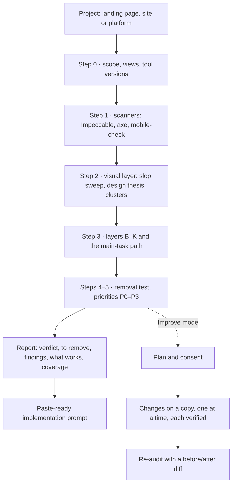

<div align="center">

# Site Mechanic

**An Agent Skill that audits and improves websites – and removes AI slop.**
It finds real problems across 11 layers and ends every report with a prompt you paste into the chat or tool that builds the site.

[](LICENSE)


[](https://github.com/dudwalski/site-mechanic/actions/workflows/check.yml)

</div>

---

## What it does

- **Judges whether a page looks deliberate.** Spots templated looks – purple gradients, cream + italic serif, icon-tile cards, "Get started →" on every button, sparkle icons, fade-up on every section – without guessing whether AI made it, and without scores.
- **Finds real defects:** accessibility (WCAG 2.2), mobile, performance, passive security, dead code, SEO and AI visibility, plain-language copy, build quality, tech stack, privacy and dark patterns (incl. the proposed EU Digital Fairness Act).
- **Every finding has evidence** – file and line, selector, measurement or tool output. Zero findings is a valid result.
- **Ends with a ready implementation prompt:** ordered tasks, where in the code, the exact change and a checkable "done when". Paste it into Claude Code, Cursor or your project chat.

## How it works



| Mode | Trigger | Output |
|---|---|---|
| **Audit** | "audit", "review", "what should I fix" | report + implementation prompt; changes nothing |
| **Improve** | "fix", "improve", "implement" | plan → consent → changes on a copy → verification → re-audit |
| **Quick** | "quick look", "first impression" | visual layer + critical defects |

## Layers

| | Layer | Examples |
|---|---|---|
| **A** | Visual (AI slop) – the main layer | slop clusters, interchangeability, brand-file conformance, first-impression research |
| **B** | Accessibility | contrast, keyboard, names – axe in a real browser |
| **C** | Performance | Core Web Vitals, images, fonts, sustainable design (WSG) |
| **D** | Security | secrets in code, forms over HTTP, headers, vulnerable libraries |
| **E** | Code economy | unused CSS and JS, duplicated libraries |
| **F** | SEO and AI visibility | indexing, metadata, AI crawlers |
| **G** | Copy | fake proof, buzzwords, plain language |
| **H** | Build quality | states, typography, the main-task path |
| **I** | Technology | versions and support of libraries, Baseline status |
| **J** | Privacy, consent and fair design | cookies, 16 dark-pattern checks, persuasion tactics graded by evidence |
| **K** | Mobile first | horizontal scroll, zoom, touch targets, content hidden on phones |

## Install

Download `site-mechanic.zip` from **[Releases](../../releases)**.

**Claude (app and claude.ai)** – in **Customize → Skills** click "+", then "Create skill" → "Upload a skill" and pick the ZIP. On team plans an admin may need to enable skills.

**Claude Code** – unzip into your personal or project skills folder:

```bash
unzip site-mechanic.zip -d ~/.claude/skills/        # all projects
unzip site-mechanic.zip -d .claude/skills/          # this project only
```

**Other Agent Skills tools** – copy `skills/site-mechanic` to wherever the tool looks for skills.

### Requirements

| For | What |
|---|---|
| Full audit with tools | a shell, Node.js 22.22.2+ or 24.15+, npm registry access |
| Mobile and in-browser accessibility | Chrome or Chromium |
| Python dependencies | Python 3 (pip-audit) – optional |
| No shell | works on screenshots and pasted code, with narrower coverage |

Tool versions are pinned; `check-versions.mjs` checks for newer ones at every audit.

## Use

```text
Audit this site: https://your-site.com
Check whether this landing page works well on phones.
Improve this page as much as you can.      (Improve mode)
Quick look before we publish.
```

<details>
<summary><b>What the implementation prompt looks like</b></summary>

```text
You are applying fixes to [name, stack]. Do the tasks in order and check
"Done when" after each.

Working rules:
- Don't change: [list from "What works – keep"].
- Don't add libraries, fonts, colours or marketing copy.

Tasks:
1. [H1] [P0] Remove the layer intercepting clicks
   Where: index.html:11, .glow
   Change: delete <div class="glow"> and the .glow rule
   Done when: elementFromPoint at the centre of "Get started" returns the link
2. …

Owner decisions – don't implement:
- [G1] a real customer testimonial, or remove the section
```

</details>

## Tests

[`evals/`](evals) holds 8 test cases and 37 criteria in skill-creator format (prompts in Polish).

| Version | With skill | Without skill | Notes |
|---|---|---|---|
| 2.3 | 27/27 | 21/27 | 7 cases |
| 2.4 | 30/30 | 20/30 | stricter criteria |
| 3.2 | – | – | not run yet |

Internal results: one run per configuration, graded by the author, small test pages. Not evidence of superiority over other tools.

## License

[MIT](LICENSE) © 2026 Michał Dudwał
